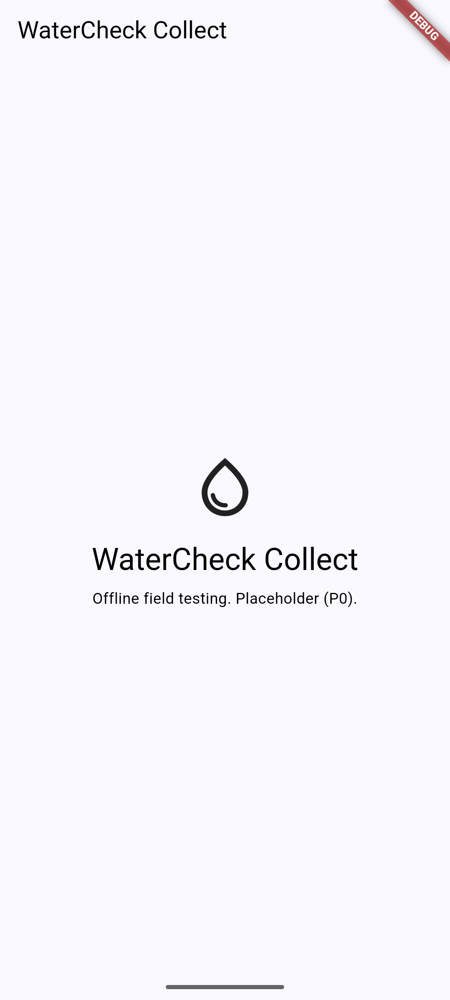

# P0 demo — Foundations

- Date: 2026-10-10
- Machine: Windows 11 Home 25H2, Flutter 3.47.6, Docker 29.8 (WSL2)

## 1. Dev stack through Caddy ✅

```text
> cd infra && cp .env.example .env && docker compose up -d --build
SERVICE   STATUS
api       Up (healthy)
caddy     Up
db        Up (healthy)
storage   Up
worker    Up

> curl -i http://localhost/health
HTTP/1.1 200 OK
Content-Type: application/json
Referrer-Policy: no-referrer
Via: 1.1 Caddy
X-Content-Type-Options: nosniff
X-Frame-Options: DENY
X-Request-Id: 7f97711d-5ea2-467f-a96f-a66b8d319ab0

{"status":"ok"}
```

Also checked:

- `http://localhost/api/health` returns `{"status":"ok"}`.
- `http://localhost/console/` and `main.dart.js` return 200 (the web Console is served by Caddy).
- The S3 endpoint on `127.0.0.1:8333` returns 200.
- The worker logs JSON heartbeats.

## 2. Apps launch with a placeholder home screen

| App | Target | Build | Launch |
|-----|--------|-------|--------|
| Console | Web (Chrome, via Caddy `/console/`) | ✅ | ✅ served at `http://localhost/console/` (200, `base href=/console/`); opened in browser |
| Console | Windows | ✅ `watercheck_console.exe` | ✅ window `watercheck_console` open and responding |
| Collect | Windows | ✅ `watercheck_collect.exe` | ✅ window `watercheck_collect` open and responding |
| Collect | Android emulator (`Medium_Phone_API_37.0`, API 37) | ✅ debug APK (x86_64) | ✅ placeholder home screen, see screenshot |



### Setup notes from this step

The local network was unstable (connection resets and DNS failures), which caused these problems:

- The Gradle auto-install of **NDK 28.2.13676358** failed. The fix was to download the zip with resumable `curl` and unpack it into `Sdk/ndk/28.2.13676358`.
- **Android SDK Platform 36** was missing. It was installed with `sdkmanager --package_file=…`; the `;` in package names breaks `.bat` arguments.
- The Flutter engine downloads for three CPU types (ABIs) kept resetting. The fix for the gate was to build for the emulator ABI only: `flutter build apk --debug --target-platform android-x64`. CI builds all ABIs.
- The emulator must be started as its own process (`Start-Process emulator.exe -avd …`). Wait for `init.svc.bootanim=stopped` before running `adb install`.

## 3. Local checks ✅

- `dart run melos run format:check`: 0 changed
- `dart run melos run analyze`: no issues
- Tests: `domain`, `data`, `ui_kit`, `collect` and `console` all pass
- Backend: `ruff format --check`, `ruff check`, `mypy --strict` and `pytest` (4 passed) all clean

## 4. gitleaks ✅ locally, ☐ in CI

- `gitleaks dir .` on the working tree: **no leaks found**.
- Fake-secret test in a throwaway repo:
  1. Committed a fake AWS access key; `gitleaks git` reported **leaks found: 1** (exit 1).
  2. Removed the commit and pruned the history; the scan reported **no leaks found** (exit 0).
- To repeat in CI once the GitHub repo exists:
  1. Push a branch with a fake key and confirm that the `security / gitleaks` job fails.
  2. Delete the branch.

## 5. CI ☐

Workflows: `flutter`, `backend`, `security` and `build` (Collect debug APK and Console web artifacts). These are pending the GitHub repo.
