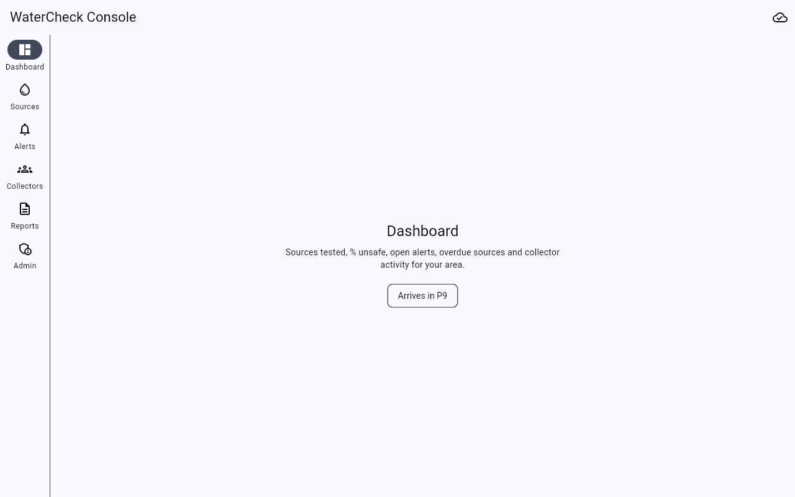
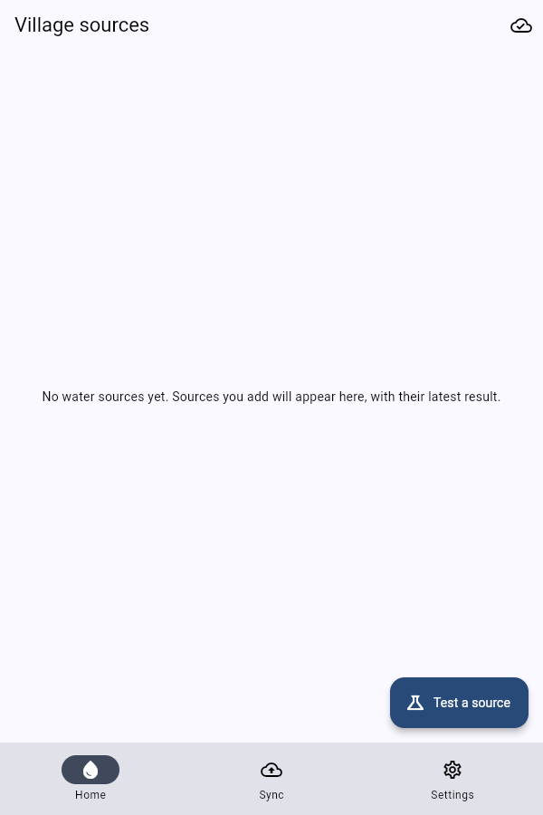
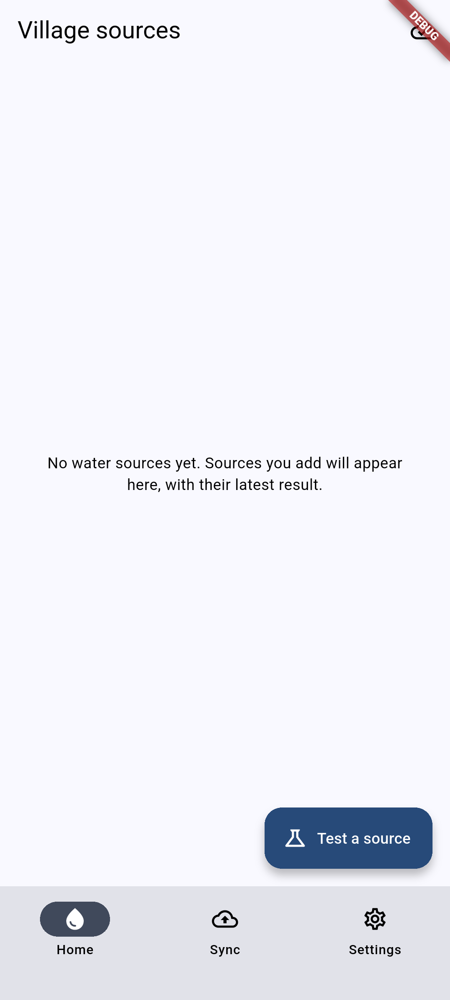
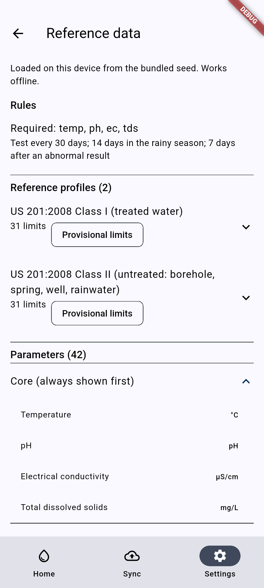

# P2 demo — Local data layer and app shells

- Date: 2026-10-10
- Machine: Windows 11, Flutter 3.47.6, Docker stack running for the web previews

## Gate checks

| Gate item | Evidence | Result |
|-----------|----------|--------|
| The DB file is unreadable without the key | `packages/data/test/encryption_test.dart`: a keyed file has no `SQLite format 3` header and no readable source or collector names; it fails without the key and with a wrong key, and reopens with the right key | ✅ |
| Same, in the real Windows apps | `%APPDATA%\ug.watercheck\watercheck_{collect,console}\watercheck.db` (229 KB each): scrambled headers, and no `US201` or `Abim` text in the first 64 KB | ✅ |
| Migration test passes from an empty DB | `test/drift/migration_test.dart`: v1 created from the saved schema (`drift_schemas/app/drift_schema_v1.json`) validates exactly | ✅ |
| Outbox rows are atomic with domain writes | `repositories_test.dart`: a submit that fails after the session and result rows are written leaves **no** session, result, reading or outbox rows; the same holds for a foreign-key failure | ✅ |
| Collect starts offline with seeded data in a debug screen | Windows: `watercheck_collect.exe` launches and the database plus seed are created locally (no network). Web preview: `http://localhost/collect/` → Settings → Reference data. Widget test `apps/collect/test/app_test.dart` | ✅ Windows, Android, web |
| Console starts on web and Windows | `http://localhost/console/` (screenshot below) and `watercheck_console.exe`. Widget tests check the rail on wide screens and the bottom bar on phones | ✅ |
| ~~Switching to the Ethur placeholder…~~ | Removed by ADR-007 (English only) | n/a |

Also checked:

- **Immutability:** readings, results and sessions refuse UPDATE and DELETE (DB triggers); only `server_seq` may be set after sync. Sources cannot be deleted (soft delete only).
- **Seed import:** idempotent. A higher seed version re-imports only that document, and user-created custom parameters and profiles survive a re-import.

## Screenshots (web previews)

Console (1280 px wide, navigation rail):

Collect (narrow window, bottom navigation):

## Android check ✅

- Debug APK (x86_64) installed on the `Medium_Phone_API_37.0` emulator, with **Wi-Fi and mobile data switched off** before launch.
- The app created its encrypted database, imported the seed and opened the home screen. Settings → Reference data lists the two US 201 profiles (31 limits each, marked provisional), the required parameters, the schedule and 42 parameters.
- **Note:** the first frame took a long time. This was a debug build on an emulator under heavy host load (load average around 30). Cold start (< 3 s, release build, low-end phone) is measured in the P3 device check.

| Home (offline) | Reference data (offline) |
|---|---|
|  |  |
